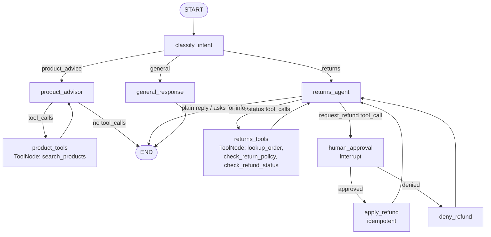
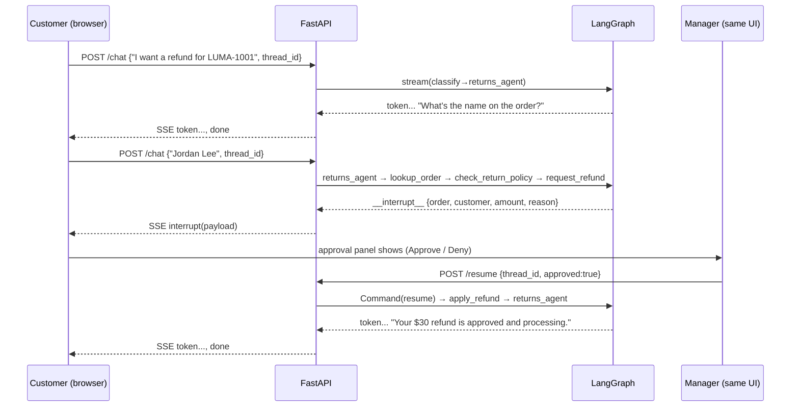

# Design Document

**Feature:** Agentic Returns Assistant (Refund-Only First Pass)

## Overview

This design upgrades the existing single-loop agent (`chatbot ⇄ tools` with one
`search_products` tool) into a **routed, multi-branch graph** with a
**human-in-the-loop (HITL) refund path**. It keeps the current product Q&A intact,
adds a returns branch that gathers order info and processes refunds step by step,
and pauses for manager approval before any refund is applied.

The work splits across three layers:

- **Graph** (`backend/app.py`): intent classifier → conditional router → two
  specialist branches (product advisor, returns agent) + a general fallback, plus a
  `human_approval` interrupt node and an idempotent `apply_refund` node.
- **Mock data** (`backend/store.py` + `backend/mock_data/orders.json`): a thin,
  file-backed data-access module behind tool functions. No database.
- **Transport** (`backend/app.py` web layer + `app.js`): the streaming protocol
  upgrades from raw `text/plain` to typed **Server-Sent Events (SSE)** so a single
  channel can carry both reply tokens and an "approval pending" control event. A new
  `POST /resume` endpoint submits the manager's decision and streams the continuation.

Design choices follow the `mastering-langgraph` skill: explicit conditional-edge
routing (not logic hidden in nodes), single-purpose nodes, `interrupt()` backed by a
checkpointer, and an **idempotent** refund step so a resume/replay can't double-pay.

### Decisions locked from requirements review

- **Router**: custom conditional edges. No `langgraph-supervisor` / `langgraph-swarm`
  dependency — keeps the whole graph visible in `app.py` and adds zero packages.
- **Scope**: refund-only. `check_inventory` / `create_shipping_label` (exchange) are
  deferred. The data file may carry an inventory map but nothing in this pass uses it.
- **Frontend**: stays vanilla HTML/CSS/JS. Changes are additive and minimal
  (SSE event handling + a small approval panel in the chat widget).

## Architecture

### Graph topology



Key idea: `request_refund` is a **signal tool**. It is bound to the returns agent's
model but is *not* in the `returns_tools` ToolNode. When the model emits a
`request_refund` call, the router sends execution to `human_approval` instead of
running a tool — that's the HITL gate. The `lookup_order`, `check_return_policy`, and
`check_refund_status` tools are normal tools that run in the ToolNode and loop back.

### Why a separate classifier node

Each user turn re-enters the graph at `START` (the frontend sends one message per
request against a stable `thread_id`). The classifier decides the branch. To satisfy
Requirement 2.5 (don't re-classify mid-flow), the classifier **short-circuits**: if
`state["active_flow"] == "returns"` and the refund isn't resolved, it stays on
`returns` without calling the LLM. Otherwise it does a cheap single-label
classification.

> Note: resuming from an interrupt does **not** pass through `classify_intent`.
> A resume re-enters at the interrupted `human_approval` node via `Command(resume=...)`,
> so the approval round-trip never gets re-routed.

## Data Models

### Graph state

```python
from typing import Annotated, Optional, TypedDict
from langgraph.graph.message import add_messages

class State(TypedDict):
    messages: Annotated[list, add_messages]   # existing reducer; merges tool msgs by id
    intent: Optional[str]                      # "product_advice" | "returns" | "general"
    active_flow: Optional[str]                 # "returns" while a refund flow is open
    pending_refund: Optional[dict]             # see "Pending refund / approval payload"
    refund_applied: bool                       # idempotency guard
```

- `messages` keeps the existing `add_messages` reducer. This satisfies the skill's
  "use an aggregator for accumulating lists" principle (the analog of `operator.add`),
  but `add_messages` is the message-specific reducer: it merges by message id and
  pairs `ToolMessage`s to their calls, which a bare `operator.add` would not do. Do
  not switch to a plain list (skill pitfall: dropped/last-only messages).
- The other fields use default "replace" semantics (no annotation needed).
- `pending_refund` carries the data captured from the `request_refund` tool call so
  the `human_approval` and `apply_refund` nodes don't have to re-parse messages.

### Mock data file: `backend/mock_data/orders.json`

```json
{
  "orders": {
    "LUMA-1001": {
      "customer_name": "Jordan Lee",
      "email": "jordan@example.com",
      "items": [{ "product": "Weekly Repair Mask", "qty": 1, "price": 30 }],
      "status": "delivered",
      "refund_status": null,
      "purchased": "2026-06-10"
    },
    "LUMA-1002": {
      "customer_name": "Priya Shah",
      "email": "priya@example.com",
      "items": [{ "product": "Repair Bond Oil", "qty": 1, "price": 32 }],
      "status": "delivered",
      "refund_status": null,
      "purchased": "2026-04-02"
    }
  },
  "inventory": { "weekly-repair-mask": 12, "repair-bond-oil": 0 }
}
```

Seed a handful of orders covering the demo cases: one refund-eligible (recent,
delivered), one outside the 30-day window (to show ineligibility), and one already
refunded (to show `check_refund_status`). Products mirror `app.js`/the KB.
`inventory` is present for the deferred exchange feature and is unused this pass.

| Field | Type | Notes |
|-------|------|-------|
| `customer_name` | string | Used for the light identity check (R3.5). |
| `email` | string | Alternate identity-check detail. |
| `items` | list of `{product, qty, price}` | Refund amount = Σ `price × qty`. |
| `status` | string | e.g. `delivered`; factors into eligibility. |
| `refund_status` | string \| null | `null` → none; `refunded` after apply. |
| `purchased` | ISO date | Drives the 30-day return window. |

### Data-access module: `backend/store.py`

A thin data-access layer so the graph never touches JSON directly (Requirement 6.6 —
swappable for a real API later):

```python
def get_order(order_number: str) -> dict | None: ...
def return_policy(order_number: str) -> dict:   # {eligible: bool, reason: str, days_since_purchase: int, window_days: 30}
def refund_status(order_number: str) -> str | None: ...
def refund_amount(order_number: str) -> float:  # sum(item.price * qty)
def apply_refund(order_number: str) -> dict:     # sets refund_status -> "refunded"; idempotent at data layer too
```

Data is loaded once at startup into an in-process dict; mutations (`apply_refund`)
update that dict so they're visible for the rest of the session (Requirement 6.3).
Policy uses a 30-day window from `purchased` (matches the site's "30 days happiness
guarantee") plus an eligible `status`.

### Pending refund / approval payload

The structure captured when the model calls `request_refund`, persisted in
`state["pending_refund"]` and surfaced to the UI in the SSE `interrupt` event:

```jsonc
{
  "type": "refund_approval",
  "order_number": "LUMA-1001",
  "customer": "Jordan Lee",
  "items": [{ "product": "Weekly Repair Mask", "qty": 1, "price": 30 }],
  "amount": 30.0,
  "reason": "Product caused irritation",
  "tool_call_id": "toolu_...",   // ties back to the request_refund call
  // added after the manager decision is applied on resume:
  "approved": true,
  "decision_reason": null,
  "reviewer": "manager-demo"
}
```

The `items` are included so the approval payload and the manager UI can show exactly
what is being refunded (Requirements 5.2 and 8.1).

## Components and Interfaces

### Tools

| Tool | In ToolNode? | Purpose |
|------|--------------|---------|
| `search_products(query)` | yes (product branch) | Existing KB retrieval. Unchanged. |
| `lookup_order(order_number)` | yes (returns branch) | Returns order summary (customer, items, status) or "not found". |
| `check_return_policy(order_number)` | yes (returns branch) | Returns eligibility + reason + days since purchase. |
| `check_refund_status(order_number)` | yes (returns branch) | Returns current refund status. |
| `request_refund(order_number, amount, reason)` | **no — signal only** | Emitted by the model when a refund is ready; intercepted by the router to trigger HITL. Never executed as a normal tool. |

Tools are thin wrappers over `store.py`. Each catches its own data errors and returns
a human-readable string rather than raising, so a bad lookup degrades gracefully
(Requirement 4.6).

### Graph nodes

- **`classify_intent`** — short-circuits to `returns` if a flow is active; else a
  single-label LLM classification into `product_advice | returns | general`. Sets
  `intent`; sets `active_flow="returns"` when entering returns. Emits no user-facing text.
- **`product_advisor`** — the *existing* chatbot behavior: model bound with
  `[search_products]`, current system prompt. Loops with `product_tools`.
- **`returns_agent`** — model bound with
  `[lookup_order, check_return_policy, check_refund_status, request_refund]` and a
  returns-specific system prompt that encodes the procedure: get order number → look
  up → light identity check (confirm name/email on the order, Requirement 3.5) →
  check policy → if eligible, state the refund amount → call `request_refund`. If
  info is missing it asks the user (plain reply → END for this turn).
- **`product_tools` / `returns_tools`** — `ToolNode`s for their respective tool sets.
- **`human_approval`** — calls `interrupt(payload)` with the pending refund details;
  on resume, reads the decision and records it. (Details below.)
- **`apply_refund`** — idempotent: if `refund_applied` or data already refunded, no-op;
  else `store.apply_refund(...)`. Appends a `ToolMessage` answering the original
  `request_refund` tool call, then returns to `returns_agent` to compose the
  confirmation. Sets `active_flow=None`, `refund_applied=True`.
- **`deny_refund`** — the deny counterpart: makes no data change, appends a
  `ToolMessage` answering the `request_refund` call with the denial (and reason), then
  returns to `returns_agent` to voice it. Sets `active_flow=None`. Exists so the
  tool-call/tool-result contract is satisfied on the deny path too.
- **`general_response`** — a plain LLM reply that can ask a clarifying question.

### Routing functions

```python
def route_intent(state) -> str:
    return state["intent"]  # "product_advisor" | "returns_agent" | "general_response"

def route_returns(state) -> str:
    last = state["messages"][-1]
    calls = getattr(last, "tool_calls", None) or []
    if any(c["name"] == "request_refund" for c in calls):
        return "human_approval"
    if calls:
        return "returns_tools"
    return "__end__"            # plain reply (e.g. asked user for order number)

def route_after_approval(state) -> str:
    return "apply_refund" if state["pending_refund"]["approved"] else "deny_refund"
```

`product_advisor` keeps using the prebuilt `tools_condition` (as today).

#### Graph assembly

Wiring the nodes and edges. Note the explicit path maps on the conditional edges
(per the `mastering-langgraph` API guidance) and, in particular, the `tools_condition`
mapping: because the product tool node is renamed `product_tools` (not the default
`tools`), `tools_condition` must be given an explicit map or routing silently fails.

```python
from langgraph.graph import StateGraph, START, END
from langgraph.prebuilt import ToolNode, tools_condition
from langgraph.checkpoint.memory import InMemorySaver

builder = StateGraph(State)
builder.add_node("classify_intent", classify_intent)
builder.add_node("product_advisor", product_advisor)
builder.add_node("product_tools", ToolNode([search_products]))
builder.add_node("returns_agent", returns_agent)
builder.add_node("returns_tools", ToolNode([lookup_order, check_return_policy, check_refund_status]))
builder.add_node("human_approval", human_approval)
builder.add_node("apply_refund", apply_refund)
builder.add_node("deny_refund", deny_refund)
builder.add_node("general_response", general_response)

builder.add_edge(START, "classify_intent")
builder.add_conditional_edges("classify_intent", route_intent,
    ["product_advisor", "returns_agent", "general_response"])

# tools_condition returns "tools" | "__end__"; remap "tools" -> our renamed node.
builder.add_conditional_edges("product_advisor", tools_condition,
    {"tools": "product_tools", "__end__": END})
builder.add_edge("product_tools", "product_advisor")

builder.add_conditional_edges("returns_agent", route_returns,
    ["returns_tools", "human_approval", "__end__"])
builder.add_edge("returns_tools", "returns_agent")

builder.add_conditional_edges("human_approval", route_after_approval,
    ["apply_refund", "deny_refund"])
builder.add_edge("apply_refund", "returns_agent")
builder.add_edge("deny_refund", "returns_agent")

builder.add_edge("general_response", END)

# Reuse the existing checkpointer instance — required for interrupt() + memory.
graph = builder.compile(checkpointer=InMemorySaver())
```

### HITL interrupt and resume

#### The message-protocol subtlety (important)

The Bedrock Converse / Anthropic API requires that an assistant message containing a
tool-use block be followed by a matching tool-result. Because `request_refund` is a
tool call the model emits, the conversation is "open" until we return a `ToolMessage`
for that `tool_call_id`. Therefore:

1. `human_approval` does **not** answer the tool call — it only pauses and captures
   the decision.
2. `apply_refund` (approve) **or** the denial branch (deny) appends the `ToolMessage`
   for the original `request_refund` `tool_call_id`, describing the outcome.
3. Control returns to `returns_agent`, which now sees a completed tool result and
   writes the final user-facing message (confirmation or denial).

This keeps the message history valid and lets the same agent voice the outcome.

#### The interrupt node

```python
from langgraph.types import interrupt

def human_approval(state):
    pr = state["pending_refund"]
    decision = interrupt({
        "type": "refund_approval",
        "order_number": pr["order_number"],
        "customer": pr["customer"],
        "items": pr["items"],
        "amount": pr["amount"],
        "reason": pr["reason"],
        "instructions": "Approve or deny this refund.",
    })
    # resumes here after POST /resume
    return {"pending_refund": {**pr,
                               "approved": bool(decision.get("approved")),
                               "decision_reason": decision.get("reason"),
                               "reviewer": decision.get("reviewer")}}
```

`pending_refund` is populated when the router detects the `request_refund` call: the
`order_number`, `amount`, and `reason` come from the call's args, while `customer`
and `items` are pulled from the order looked up earlier in the flow. The checkpointer
(existing `InMemorySaver`) persists the paused state keyed by `thread_id` (Requirement 5.3).

#### Idempotent apply

`apply_refund` guards against double application (Requirement 5.6), echoing the
skill's durable-execution rule:

```python
def apply_refund(state):
    pr = state["pending_refund"]
    if not state.get("refund_applied") and store.refund_status(pr["order_number"]) != "refunded":
        store.apply_refund(pr["order_number"])
    tool_msg = ToolMessage(content=f"Refund of ${pr['amount']} processed for {pr['order_number']}.",
                           tool_call_id=pr["tool_call_id"])
    return {"messages": [tool_msg], "refund_applied": True, "active_flow": None}
```

### Backend API

#### Streaming protocol: text/plain → SSE

Today `/chat` streams `text/plain`. To carry both tokens and a structured "approval
pending" event on one connection, switch to **SSE** (`text/event-stream`) with typed
events:

| SSE event | data | Meaning |
|-----------|------|---------|
| `token` | reply text fragment | append to the current bot bubble |
| `interrupt` | JSON approval payload | graph paused; render approval panel |
| `done` | `[DONE]` | turn finished |
| `error` | message | something failed |

The graph is streamed with **multiple stream modes** so one loop sees both tokens and
the interrupt signal:

```python
for mode, payload in graph.stream(inputs, config=config, stream_mode=["messages", "updates"]):
    if mode == "messages":
        chunk, meta = payload
        if meta.get("langgraph_node") in USER_FACING_NODES:   # product_advisor, returns_agent, general_response
            text = _to_text(chunk.content)
            if text: yield sse("token", text)
    elif mode == "updates" and "__interrupt__" in payload:
        intr = payload["__interrupt__"][0]
        yield sse("interrupt", json.dumps(intr.value))
```

`USER_FACING_NODES` whitelists the three text-producing nodes so classifier/tool/
approval plumbing never leaks to the user (same spirit as today's node filter).

#### Endpoints

- **`POST /chat`** — unchanged request `{ message, thread_id }`. Now returns SSE.
  Runs the graph for a normal turn; may end with a `token`/`done` pair, or with an
  `interrupt` event when a refund hits the approval gate.
- **`POST /resume`** — new. Request `{ thread_id, approved: bool, reason?, reviewer? }`.
  Resumes the paused graph and streams the continuation as SSE:

  ```python
  graph.stream(Command(resume={"approved": approved, "reason": reason, "reviewer": reviewer}),
               config={"configurable": {"thread_id": thread_id}},
               stream_mode=["messages", "updates"])
  ```

  Streams the post-approval confirmation/denial tokens, then `done`. The dict passed
  to `Command(resume=...)` becomes the return value of the `interrupt()` call inside
  `human_approval`, which is how the manager's decision re-enters the graph
  (`langgraph>=1.0` resume contract).

Existing input-size guard and CORS stay (Requirement 7.5). Health endpoint updates
its `stage` label.

### Frontend interface (minimal, vanilla JS)

All in `app.js` — no framework, no build step, additive only:

1. **SSE event parsing** — `readStream()` already splits SSE frames but treats every
   `data:` line as a token. Extend it to read the `event:` line and dispatch:
   `token` → append (existing behavior), `interrupt` → render approval panel,
   `done`/`error` → finish. This is the one non-trivial change and it's localized.
2. **Approval panel** — a small inline element appended into the chat message list
   when an `interrupt` arrives, showing order, customer, item(s), amount, and reason
   plus two buttons (Approve / Deny). Styled with existing CSS classes where possible;
   minimal new CSS if needed. (Requirement 8.1)
3. **Resume call** — on Approve/Deny, `POST /resume` with the stored `thread_id` and
   the decision, then stream the continuation into a new bot bubble using the same
   reader. While pending, show a small "awaiting manager approval" note (Requirement 8.3).

The "manager" and "customer" are the same browser in the demo; the panel is the
lightweight manager affordance (Requirement 8.4). No auth.

## Sequence — refund happy path



Denied path is identical until `/resume {approved:false}` → `deny_refund` (no data
mutation, appends the denial tool result) → `returns_agent` voices the denial with
the manager's reason.

## Error Handling

| Case | Handling |
|------|----------|
| Order not found | `lookup_order` returns "not found"; agent asks user to recheck (R3.3). |
| Not eligible | `check_return_policy` returns ineligible + reason; agent explains, no approval (R4.2). |
| Tool exception | Caught in tool wrapper, returned as message; conversation continues (R4.6). |
| Resume without pending interrupt | `/resume` checks `get_state(...).next`; if nothing is interrupted, returns a clear error. |
| Double approve (replay) | `apply_refund` idempotency guard + data-layer check (R5.6). |
| Model classifies wrong | `general_response` can ask a clarifying question; user can restate (R2.4). |

## Correctness Properties

Invariants the implementation and tests must uphold:

1. **No refund without approval** — `store.apply_refund` is reachable only via the
   `human_approval → apply_refund` edge, and only when `pending_refund.approved` is
   true. There is no other call site. (R5.1, R5.7)
2. **Refund idempotency** — applying a refund is a no-op if the order is already
   `refunded` or `refund_applied` is set; a resume/replay never double-pays. (R5.6)
3. **Message-protocol validity** — every `request_refund` tool call is eventually
   answered by exactly one `ToolMessage` (from the approve or deny branch) before the
   next model turn, so the Converse/Anthropic contract is never violated.
4. **Routing exhaustiveness** — `classify_intent` always yields one of
   `product_advice | returns | general`; `route_intent` maps each to a real node, so
   no turn dead-ends unrouted. Ambiguity falls through to `general`. (R2.1, R2.4)
5. **Flow stickiness** — while `active_flow == "returns"` and unresolved, turns stay
   on the returns branch rather than being re-classified. (R2.5)
6. **Eligibility gate** — an ineligible order never produces a `request_refund` call;
   the agent stops at the explanation step. (R4.2)
7. **Memory continuity** — replies for a given `thread_id` always build on prior turns
   via the checkpointer; a different `thread_id` is isolated. (R1.4)
8. **No internal leakage** — only `USER_FACING_NODES` text reaches the client; tool
   output, classifier labels, and interrupt plumbing never stream as `token`s.

## Testing Strategy

Unit-level, no live AWS needed for most:

- **`store.py`**: order lookup, policy eligibility (in/out of window), refund amount,
  idempotent `apply_refund`.
- **Tools**: each returns graceful strings on missing/invalid input.
- **Routing functions**: `route_returns` for each case (request_refund call, normal
  tool calls, plain reply); `route_after_approval` approve/deny.
- **HITL flow** (mock the LLM or use a scripted message): graph pauses at
  `human_approval`, `get_state().next` shows the interrupt; resume with approve →
  data mutated + confirmation; resume with deny → data unchanged.
- **Idempotency**: resume/replay does not double-apply.
- **Regression**: a product question still routes to `product_advisor` and retrieves.

Verify with the skill's checklist: graph compiles, `draw_mermaid()` renders, lists
accumulate (`add_messages`), memory persists across turns on one `thread_id`, each
routing branch reachable.

## Dependencies and Configuration

- No new Python deps required for the locked design (no supervisor/swarm package).
  `langgraph`, `langchain-aws`, `fastapi`, `uvicorn`, `python-dotenv` already present.
- New files: `backend/store.py`, `backend/mock_data/orders.json`.
- `MODEL_ID`, `AWS_REGION`, `KNOWLEDGE_BASE_ID` unchanged. Classification reuses the
  same model (one extra short LLM call per non-flow turn — acceptable for a demo;
  noted as a cost trade-off).

## Requirements Coverage

| Requirement | Addressed by |
|-------------|--------------|
| R1 Preserve product Q&A | `product_advisor` + `product_tools` unchanged; whitelist streams its text |
| R2 Intent routing | `classify_intent` + `route_intent`; `active_flow` short-circuit |
| R3 Order-number identity | `lookup_order`; returns-agent prompt does light identity check |
| R4 Multi-step refund | `check_return_policy`, refund amount, `check_refund_status`; distinct steps |
| R5 HITL refund approval | `human_approval` interrupt + `apply_refund` idempotent + resume |
| R6 Mock data, no DB | `store.py` + `orders.json`, in-memory mutation, isolated behind tools |
| R7 Pause/resume API | SSE protocol, `/chat` + new `/resume`, guards retained |
| R8 Manager approval UI | `app.js` SSE `interrupt` handling + inline approval panel, vanilla JS |
