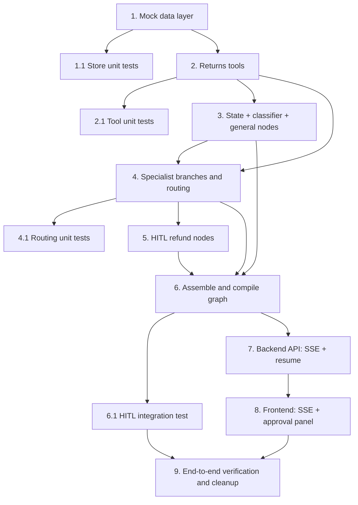

# Implementation Plan

**Feature:** Agentic Returns Assistant (Refund-Only First Pass)

## Overview

Each task is incremental and builds on the previous ones. Tasks are ordered so the
app stays runnable: data layer → tools → graph nodes/routing → HITL → API → frontend,
with tests alongside. Requirement references map back to `requirements.md`, and the
node/edge design maps back to `design.md`.

The build proceeds in three layers, mirroring the design:

- **Mock data** (`backend/store.py` + `backend/mock_data/orders.json`) — a thin,
  file-backed data-access module behind tool functions.
- **Graph** (`backend/app.py`) — intent classifier → conditional router → product
  advisor / returns agent / general fallback, plus the `human_approval` interrupt and
  idempotent `apply_refund` nodes.
- **Transport** (`backend/app.py` web layer + `app.js`) — SSE streaming and a
  `POST /resume` endpoint, with a minimal vanilla-JS approval panel.

## Tasks

- [x] 1. Mock data layer (orders + store module)
  - Create `backend/mock_data/orders.json` seeded with at least three orders: one
    refund-eligible (recent, `delivered`), one outside the 30-day window (to show
    ineligibility), and one already `refunded` (to show status lookup). Products must
    match the existing catalog in `app.js` / the knowledge base.
  - Create `backend/store.py` with an in-process load-at-startup dict and functions:
    `get_order`, `return_policy` (30-day window from `purchased` + eligible status →
    `{eligible, reason, days_since_purchase, window_days}`), `refund_status`,
    `refund_amount` (Σ `price × qty`), and `apply_refund` (sets `refund_status="refunded"`,
    idempotent at the data layer).
  - _Requirements: 6.1, 6.2, 6.3, 6.4, 6.5, 6.6_

- [x] 1.1 Unit tests for the store
  - Test order lookup (found / not found), eligibility in-window vs out-of-window,
    refund amount computation, and that `apply_refund` is idempotent (second call is a no-op).
  - _Requirements: 6.2, 6.3, 4.1_

- [x] 2. Returns tools
  - In `backend/app.py`, add `@tool` functions wrapping `store.py`: `lookup_order`,
    `check_return_policy`, `check_refund_status`. Each returns a human-readable string
    and catches its own errors (no raises) so a bad lookup degrades gracefully.
  - Add the `request_refund(order_number, amount, reason)` **signal tool** with a clear
    docstring instructing the model to call it only when a refund is verified and ready.
    It is bound to the model but will NOT be placed in a ToolNode (handled in task 4).
  - _Requirements: 3.2, 3.3, 4.1, 4.4, 4.6_

- [x] 2.1 Unit tests for tools
  - Verify each tool returns graceful strings on missing/invalid order numbers and
    correct content on valid ones.
  - _Requirements: 3.3, 4.6_

- [x] 3. Extend graph state and add classifier + general nodes
  - Extend the `State` TypedDict with `intent`, `active_flow`, `pending_refund`,
    `refund_applied` (keep `messages` on the existing `add_messages` reducer).
  - Implement `classify_intent`: short-circuit to `returns` when `active_flow == "returns"`
    and the refund is unresolved; otherwise a single-label LLM classification into
    `product_advice | returns | general`. Set `intent` and `active_flow` accordingly.
    Emit no user-facing text.
  - Implement `general_response` (plain reply that can ask a clarifying question).
  - Implement the `route_intent` routing function.
  - _Requirements: 2.1, 2.2, 2.3, 2.4, 2.5, 2.6_

- [x] 4. Specialist branches and routing
  - Refactor the existing chatbot into `product_advisor` (model bound with
    `[search_products]`, current system prompt) looping with a `product_tools` ToolNode.
  - Implement `returns_agent` (model bound with `[lookup_order, check_return_policy,
    check_refund_status, request_refund]`) with a returns system prompt that encodes the
    procedure: ask for order number if missing → look up → light identity check
    (confirm name/email on the order) → check policy → if eligible, state the refund
    amount → call `request_refund`. Add the `returns_tools` ToolNode (the three normal
    tools only; `request_refund` is excluded).
  - Implement `route_returns` (request_refund → `human_approval`; other tool calls →
    `returns_tools`; plain reply → `__end__`).
  - _Requirements: 1.1, 1.3, 3.1, 3.4, 3.5, 4.1, 4.2, 4.3, 4.5_

- [x] 4.1 Unit tests for routing functions
  - Test `route_returns` for the three cases (request_refund call, normal tool calls,
    plain reply) and `route_intent` for each intent label.
  - _Requirements: 2.6, 4.5_

- [x] 5. Human-in-the-loop refund nodes
  - Implement `human_approval` using `interrupt()` with the approval payload
    (`order_number`, `customer`, `items`, `amount`, `reason`, instructions); on resume,
    record `approved` / `decision_reason` / `reviewer` into `pending_refund`. Populate
    `pending_refund` from the `request_refund` args + the looked-up order (customer, items).
  - Implement `apply_refund`: idempotent (no-op if `refund_applied` or already refunded),
    call `store.apply_refund`, append a `ToolMessage` answering the `request_refund`
    `tool_call_id`, set `active_flow=None` and `refund_applied=True`.
  - Implement `deny_refund`: no data change, append a `ToolMessage` answering the
    `request_refund` call with the denial + reason, set `active_flow=None`.
  - Implement `route_after_approval` (approved → `apply_refund`, else → `deny_refund`).
  - _Requirements: 5.1, 5.2, 5.3, 5.4, 5.5, 5.6, 5.7_

- [x] 6. Assemble and compile the graph
  - Wire all nodes and edges per the design's Graph assembly: `START → classify_intent`,
    conditional `route_intent`, `product_advisor` with `tools_condition` remapped to
    `{"tools": "product_tools", "__end__": END}`, `returns_agent` conditional via
    `route_returns`, `human_approval` conditional via `route_after_approval`,
    `apply_refund`/`deny_refund` → `returns_agent`, `general_response → END`.
  - Compile with the existing `InMemorySaver` checkpointer (required for `interrupt()`
    and memory). Verify `graph.get_graph().draw_mermaid()` renders and every branch is
    reachable.
  - _Requirements: 1.4, 2.6, 5.3_

- [x] 6.1 Integration test for the HITL flow
  - Drive the graph with scripted/mocked model output: confirm it pauses at
    `human_approval` (`get_state().next` shows the interrupt); resume with approve →
    data mutated + confirmation; resume with deny → data unchanged + denial. Assert the
    refund is not double-applied on replay, and that a product question still routes to
    `product_advisor`.
  - _Requirements: 5.1, 5.4, 5.5, 5.6, 5.7, 1.1_

- [x] 7. Backend API: SSE streaming + resume endpoint
  - Convert `/chat` to stream Server-Sent Events with typed events (`token`,
    `interrupt`, `done`, `error`). Stream the graph with `stream_mode=["messages",
    "updates"]`; forward only `USER_FACING_NODES` text as `token`s, and emit an
    `interrupt` event with the payload when `__interrupt__` appears. Keep the
    `{ message, thread_id }` request shape, input-size guard, and CORS.
  - Add `POST /resume` accepting `{ thread_id, approved, reason?, reviewer? }`; resume
    via `graph.stream(Command(resume={...}), config=...)` and stream the continuation as
    SSE. Guard against resuming when nothing is interrupted (check `get_state().next`).
  - Update the health endpoint's `stage` label.
  - _Requirements: 7.1, 7.2, 7.3, 7.4, 7.5_

- [x] 8. Frontend: SSE event handling + approval panel (vanilla JS)
  - In `app.js`, extend `readStream()` to dispatch on the SSE `event:` type: `token` →
    append (existing behavior), `interrupt` → render the approval panel, `done`/`error`
    → finish. Keep raw-text fallback behavior intact.
  - Render an inline approval panel in the chat message list showing order, customer,
    item(s), amount, and reason with Approve / Deny buttons; show a small "awaiting
    manager approval" note while pending.
  - On Approve/Deny, `POST /resume` with the stored `thread_id` and the decision, then
    stream the continuation into a new bot bubble using the same reader.
  - Keep changes additive and minimal; reuse existing CSS classes, add minimal new CSS
    only if needed. No framework, no build step, no new dependencies.
  - _Requirements: 8.1, 8.2, 8.3, 8.4, 8.5_

- [x] 9. End-to-end verification and cleanup
  - Run the backend and exercise the demo flows manually: product Q&A (regression),
    refund happy path (ask → order number → identity → policy → approval → approve →
    confirmation), refund denied, ineligible order, and order-not-found.
  - Confirm memory continuity across turns on one `thread_id` and isolation across
    different `thread_id`s. Confirm no internal node text leaks to the client.
  - Update `backend/app.py` module docstring / stage label and pin deps if needed.
  - _Requirements: 1.2, 1.4, 2.4, 4.2, 4.6_

## Task Dependency Graph



```json
{
  "waves": [
    { "wave": 1, "tasks": ["1"] },
    { "wave": 2, "tasks": ["1.1", "2"] },
    { "wave": 3, "tasks": ["2.1", "3"] },
    { "wave": 4, "tasks": ["4"] },
    { "wave": 5, "tasks": ["4.1", "5"] },
    { "wave": 6, "tasks": ["6"] },
    { "wave": 7, "tasks": ["6.1", "7"] },
    { "wave": 8, "tasks": ["8"] },
    { "wave": 9, "tasks": ["9"] }
  ]
}
```

Notes on the ordering:

- Tasks 1 → 2 → 3 → 4 → 5 → 6 form the critical path (data → tools → graph).
- Test tasks (1.1, 2.1, 4.1, 6.1) depend on the feature task they verify and can run
  immediately after it.
- Task 6 (graph assembly) needs the nodes from tasks 3, 4, and 5 in place.
- Transport tasks (7 → 8) depend on a compiled graph (task 6) and feed the final
  end-to-end verification (task 9).

## Notes

- **Requirement traceability:** every task lists the `requirements.md` acceptance
  criteria it satisfies. Task 9 closes the loop by exercising the user-visible flows
  end to end.
- **Runnable at each step:** tasks are sequenced so the app keeps starting and the
  existing product Q&A keeps working throughout the migration.
- **Testing is interleaved, not deferred:** unit tests sit next to the code they cover
  (1.1, 2.1, 4.1) and the HITL integration test (6.1) follows graph assembly.
- **Scope guard:** product *exchanges* (`check_inventory`, `create_shipping_label`)
  are deferred. The `inventory` map in `orders.json` may exist but no task this pass
  depends on it.
- **No new dependencies:** the design is built on the packages already present
  (`langgraph`, `langchain-aws`, `fastapi`, `uvicorn`, `python-dotenv`). Frontend stays
  vanilla HTML/CSS/JS.
- **Design alignment:** node names, routing functions, and the SSE event contract in
  these tasks match `design.md`; consult it for the full node/edge wiring and the
  message-protocol subtlety around `request_refund`.
