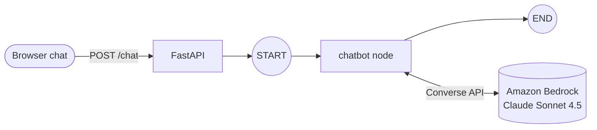
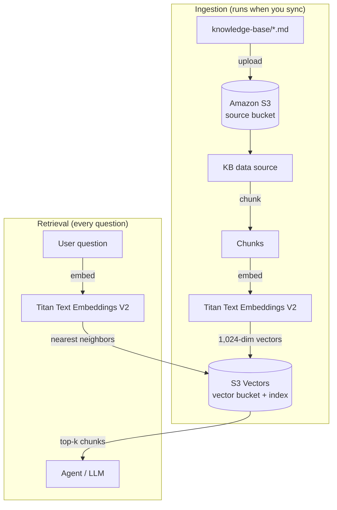
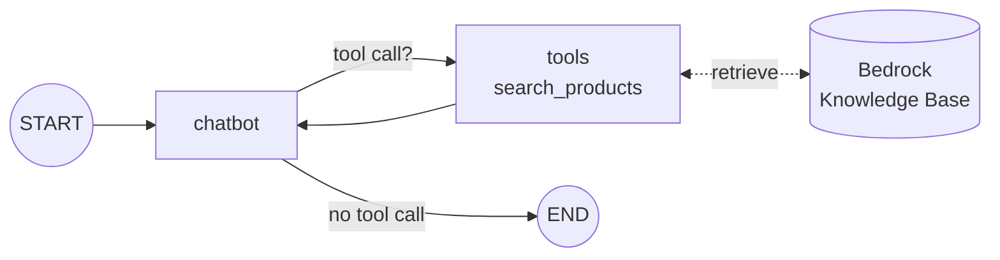
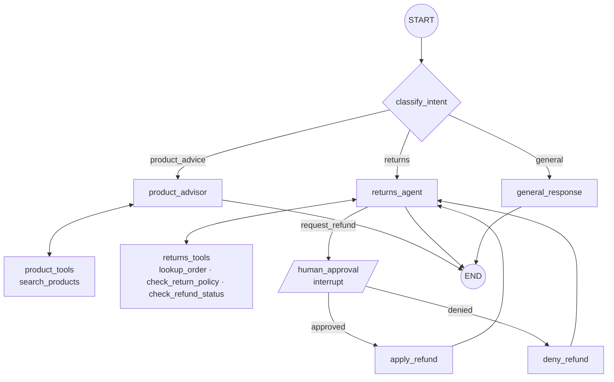
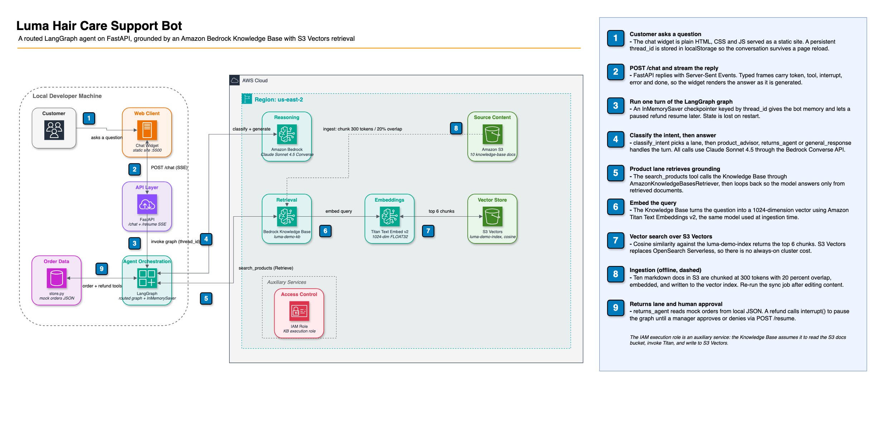

# Luma Hair Care: Building a RAG Support Agent with LangGraph and Amazon Bedrock

A hands-on tutorial that turns a static hair-care storefront into a grounded, tool-using AI support agent, one git tag at a time.

You start with a chat widget that only plays a canned reply. By the end, the same widget talks to a LangGraph agent on Amazon Bedrock that answers from a real Knowledge Base, remembers the conversation, routes requests to specialist branches, and pauses for a human manager before it issues a refund.

Each stage is a git tag. Check out a tag, run it, see what changed, then move to the next one.

| Tag | What you get |
|---|---|
| [`v1-frontend-only`](#v1-frontend-only--static-storefront) | Storefront and chat UI. No backend. |
| [`v2-model-no-rag`](#v2-model-no-rag--a-raw-model-that-hallucinates) | Chat wired to a Bedrock model through a one-node LangGraph graph. It makes things up. |
| [`v2.1-kb-provisioned`](#v21-kb-provisioned--the-knowledge-base) | A Bedrock Knowledge Base is built from the product docs. App code unchanged. |
| [`v3-rag`](#v3-rag--grounded-answers-with-tools-and-memory) | The agent retrieves from the Knowledge Base, loops with tools, and remembers context. |
| [`v4-returns-hitl`](#v4-returns-hitl--routing-and-human-in-the-loop-refunds) | Intent routing, a returns specialist, and manager approval for refunds. |
| [`v5-markdown-chat-ui`](#v5-markdown-chat-ui--polished-replies) | Markdown rendering in chat, trace logging, and an architecture diagram. |

## Contents

- [What you'll learn](#what-youll-learn)
- [Prerequisites](#prerequisites)
- [Get the code](#get-the-code)
- [Walk through the stages](#walk-through-the-stages)
- [Project layout](#project-layout)
- [Configuration reference](#configuration-reference)
- [Troubleshooting](#troubleshooting)
- [Clean up AWS resources](#clean-up-aws-resources)

## What you'll learn

- **Why raw LLMs hallucinate** about your business, and how **RAG** (retrieval-augmented generation) fixes it.
- **How a Bedrock Knowledge Base works**: S3, chunking, embeddings, vectors and similarity search.
- **LangGraph fundamentals**: state, nodes, edges, conditional routing, tool loops, checkpointer memory and `interrupt()`.
- **How the Agent Toolkit for AWS** lets your AI coding assistant provision AWS resources for you.

## Prerequisites

| Requirement | Needed from | Notes |
|---|---|---|
| Git and a web browser | v1 | That's all v1 needs. |
| Python 3.11+ | v2 | Built and tested on Python 3.13. |
| An AWS account with local credentials | v2 | `aws sts get-caller-identity` should print your identity. |
| Bedrock model access | v2 | Anthropic Claude Sonnet 4.5 (chat) and Amazon Titan Text Embeddings V2 (Knowledge Base). |
| [Agent Toolkit for AWS](https://github.com/aws/agent-toolkit-for-aws) | v2.1 | Optional. Your AI coding assistant uses it to build the Knowledge Base for you. |

## Get the code

```bash
git clone https://github.com/<your-github-user>/luma-hair-care.git
cd luma-hair-care
git tag            # lists every stage
```

Switch stages with `git checkout <tag>`. Git warns that you're in a "detached HEAD" state. That's expected: you're viewing a snapshot, not working on a branch. Run `git checkout main` to return to the finished version.

---

## Walk through the stages

### v1-frontend-only · Static storefront

```bash
git checkout v1-frontend-only
open index.html                  # macOS; or double-click the file
# or serve it:
python3 -m http.server 5500      # then visit http://localhost:5500
```

**What's happening**

A plain HTML/CSS/JS storefront with a product grid, product detail modals and a support chat widget. There's no backend yet. Every message you send gets the same canned reply, streamed word by word so the UI already looks live.

The frontend was built to be ready for the agent from day one. It sends a `thread_id` with each request so the backend can remember the conversation later. It can also read a streamed response token by token.

```js
// app.js
const CHAT_API_URL = null;   // no backend yet

async function sendToBackend(text, onToken) {
  if (!CHAT_API_URL) {
    const msg = "Thanks for your message! Our AI assistant isn't live just yet...";
    await simulateStream(msg, onToken);   // fake the streaming effect
    return msg;
  }
  // ...real fetch() to the backend comes in v2
}
```

**Try it:** ask anything. You'll get the same reply every time.

> The `knowledge-base/` folder already holds markdown docs for every product, plus an FAQ and a hair-type guide. These become the source of truth for RAG in v2.1.

---

### v2-model-no-rag · A raw model that hallucinates

```bash
git checkout v2-model-no-rag
```

**One-time backend setup** (in a second terminal):

```bash
cd backend
python3 -m venv .venv
source .venv/bin/activate
pip install -r requirements.txt
cp .env.example .env              # then set MODEL_ID and AWS_REGION
aws sts get-caller-identity       # confirm your AWS credentials work
```

**Run it:**

```bash
uvicorn app:app --reload --port 8000
```

Keep the frontend open from v1 (or serve it again) and refresh the page.

**What's happening**

The chat widget now POSTs to a FastAPI server, which runs a **LangGraph** graph with exactly one node. That node sends the conversation to Claude on **Amazon Bedrock** through the Converse API and streams the reply back.



**Key concepts**

- **State** is the shared data passed between nodes. Here it's just a list of messages.
- **A node** is a Python function that reads state and returns an update.
- **Edges** define the order nodes run in.

```python
# backend/app.py
class State(TypedDict):
    messages: Annotated[list, add_messages]   # add_messages appends instead of overwriting

def chatbot(state: State) -> dict:
    return {"messages": [llm.invoke(state["messages"])]}

builder = StateGraph(State)
builder.add_node("chatbot", chatbot)
builder.add_edge(START, "chatbot")
builder.add_edge("chatbot", END)
graph = builder.compile()
```

```js
// app.js: the only frontend change
const CHAT_API_URL = "http://localhost:8000/chat";
```

**Try it:**

```text
What products are available?
What's in the Hydra Wash Shampoo?
```

The answers sound confident and are mostly wrong. The model has never seen Luma's catalog, so it invents products, ingredients and prices. It also has no memory: each message starts fresh.

> **This is the problem RAG solves.** The model is capable, but it doesn't know your business. Instead of retraining it, you look up the relevant facts at question time and hand them to the model.

---

### v2.1-kb-provisioned · The Knowledge Base

```bash
git checkout v2.1-kb-provisioned
```

The app code is identical to v2. This stage builds the AWS infrastructure that v3 will query, and records it in `backend/infra/`.

#### Build it with the Agent Toolkit for AWS

The [Agent Toolkit for AWS](https://github.com/aws/agent-toolkit-for-aws) gives AI coding assistants (Kiro, Claude Code, Codex, Cursor) an authenticated AWS MCP server plus tested skills for tasks like building a Knowledge Base. Install it, then ask your assistant:

```text
Use the Agent Toolkit for AWS to upload the documents in the knowledge-base folder
to a Bedrock Knowledge Base and give me back the Knowledge Base ID once done.
```

Put the returned ID into `backend/.env`:

```bash
KNOWLEDGE_BASE_ID=XXXXXXXXXX
```

> Keep the Knowledge Base and the model in the **same region**. `AWS_REGION` in `.env` is used for both.

#### Key concepts

**Embeddings and vectors.** An embedding model reads a piece of text and outputs a list of numbers, called a **vector**, that captures its *meaning*. Titan Text Embeddings V2 outputs 1,024 numbers per chunk. Texts with similar meanings get vectors that sit close together, even when they share no words. "Is it OK for dyed hair?" lands near "color-safe formula."

```text
"Color-safe, sulfate-free, and pH-balanced."  →  [0.021, -0.113, 0.087, ... 1,024 values]
```

**Vectorization (ingestion)** is the pipeline that turns your documents into searchable vectors:

1. **Chunking.** Each document is split into small passages (about 300 tokens) so a search returns a focused paragraph instead of a whole file.
2. **Embedding.** Each chunk is sent to the embedding model to get its vector.
3. **Indexing.** The vector, the chunk text and its source file are written to a vector index.

**Similarity search (retrieval).** At question time, the user's question is embedded with the *same* model. The vector store returns the chunks whose vectors are closest to it, measured by **cosine similarity**. Those chunks become the facts the LLM answers from.

#### The components



| Component | Role |
|---|---|
| **Amazon S3 bucket** | Ordinary object storage that holds the raw markdown docs. It's the Knowledge Base's source of truth. |
| **Amazon Bedrock** | Managed service for foundation models. It hosts Claude (chat) and Titan (embeddings), and runs Knowledge Bases. |
| **Bedrock Knowledge Base** | The orchestrator. It manages chunking, embedding, storage and retrieval so you don't build a RAG pipeline by hand. |
| **Data source** | The KB's link to the S3 bucket, plus the chunking settings. Chunking can't be changed after creation. |
| **Ingestion job (sync)** | One run of the chunk → embed → index pipeline. Re-run it whenever the docs change. |
| **Titan Text Embeddings V2** | The embedding model that turns text into 1,024-dimension vectors. |
| **Amazon S3 Vectors** | Purpose-built, low-cost vector storage: a *vector bucket* containing an *index* configured for 1,024 dimensions and cosine distance. |
| **IAM service role** | Lets Bedrock read the S3 bucket, call Titan and write to the vector index, scoped to exactly those resources. |

The manifest in `backend/infra/` records what was created:

```json
// backend/infra/kb-storage-config.json
{
  "type": "S3_VECTORS",
  "s3VectorsConfiguration": {
    "vectorBucketArn": "arn:aws:s3vectors:<region>:<account>:bucket/luma-demo-vectors-<account>",
    "indexName": "luma-demo-index"
  }
}
```

**Try it** without any app code, straight from the CLI:

```bash
aws bedrock-agent-runtime retrieve \
  --knowledge-base-id "$KNOWLEDGE_BASE_ID" \
  --retrieval-query '{"text": "Is the curl cream safe for color-treated hair?"}'
```

You'll get back chunks from `define-curl-cream.md`, each with a relevance score.

---

### v3-rag · Grounded answers with tools and memory

```bash
git checkout v3-rag
```

Restart the backend (Ctrl+C, then `uvicorn app:app --reload --port 8000`) and refresh the browser. Make sure `KNOWLEDGE_BASE_ID` is set in `backend/.env`.

**What's happening**

The single node becomes an **agent loop**. The model gets a `search_products` tool that queries the Knowledge Base. For each question, the model decides whether to call it, reads what comes back, and then answers from those facts only.



**Key concepts**

- **Tools.** A Python function the model can choose to call. `bind_tools()` tells the model the tool exists. The function's docstring is how the model knows when to use it.
- **Conditional edges.** `tools_condition` checks the model's reply. If it requested a tool, the graph goes to `tools`; otherwise it ends.
- **The loop.** `tools → chatbot` sends the retrieved text back to the model so it can answer, or search again.
- **Memory (checkpointer).** `InMemorySaver` saves each conversation's state under its `thread_id`, so follow-up questions have context.

```python
# backend/app.py
retriever = AmazonKnowledgeBasesRetriever(
    knowledge_base_id=KNOWLEDGE_BASE_ID,
    retrieval_config={"vectorSearchConfiguration": {"numberOfResults": 4}},
)

@tool
def search_products(query: str) -> str:
    """Search Luma Hair Care's knowledge base for product, ingredient,
    routine, or policy information."""
    docs = retriever.invoke(query)
    return "\n\n---\n\n".join(d.page_content for d in docs)

llm_with_tools = llm.bind_tools([search_products])

builder.add_node("chatbot", chatbot)
builder.add_node("tools", ToolNode([search_products]))
builder.add_edge(START, "chatbot")
builder.add_conditional_edges("chatbot", tools_condition)
builder.add_edge("tools", "chatbot")
graph = builder.compile(checkpointer=InMemorySaver())
```

The system prompt does the grounding: *"ALWAYS call the search_products tool first and base your answer only on the information it returns... If the retrieved information doesn't cover the question, say you're not sure."*

**Try it:**

```text
What products are available?
Is the Define Curl Cream safe for color-treated hair?
How often should I use it?          ← "it" works because of memory
```

Answers now match the real product docs. Compare them with your v2 answers.

> Memory lives in the server's RAM. Restarting the backend clears every conversation.

---

### v4-returns-hitl · Routing and human-in-the-loop refunds

```bash
git checkout v4-returns-hitl
cd backend && pip install -r requirements.txt   # versions are pinned from this stage on
```

Restart the backend and refresh the browser.

**What's happening**

The bot now handles two jobs: product questions and refunds. Instead of one agent doing everything, a classifier routes each message to a **specialist branch**. Refunds involve money, so the graph **pauses** and asks a human manager to approve or deny before anything changes.



**Key concepts**

- **Routing.** `classify_intent` makes a cheap one-word LLM call (`product_advice`, `returns` or `general`). A router function maps that label to the next node.
- **Specialists.** Each branch has its own prompt and its own tools. The returns agent can look up orders but can't search products, and the reverse is true for the product advisor.
- **Richer state.** State now tracks `intent`, `active_flow`, `pending_refund` and `refund_applied`, not just messages.
- **Human in the loop.** `interrupt()` pauses the graph and saves its state through the checkpointer. The frontend shows Approve/Deny buttons. Clicking one calls `/resume`, which continues the graph exactly where it stopped.
- **A signal tool.** `request_refund` is never executed directly. When the model calls it, the router redirects to `human_approval`.

```python
# backend/app.py: pause for a manager's decision
def human_approval(state: State) -> dict:
    ...
    decision = interrupt({
        "type": "refund_approval",
        "order_number": order_number,
        "customer": customer,
        "amount": amount,
        "reason": reason,
    })
    return {"pending_refund": {**pending, "approved": bool(decision.get("approved"))}}

# POST /resume: continue the paused graph with the decision
graph.stream(Command(resume={"approved": True, "reviewer": "manager"}), config)
```

Orders come from `backend/mock_data/orders.json` through `backend/store.py`, a thin data layer you could swap for a real order API.

**Try it:**

```text
I'd like a refund for order LUMA-1001. My name is Jordan Lee.
```

The agent looks up the order, checks the 30-day return policy, confirms the amount with you, then shows an approval panel. Approve it and the refund is applied. Ask again and the agent reports it's already refunded.

> **Heads up: the return window uses today's date.** Orders older than 30 days are rejected. If the demo order has aged out, set `"purchased"` for `LUMA-1001` in `backend/mock_data/orders.json` to a date within the last 30 days, then restart the backend.

Run the test suite from `backend/`. The LLM is mocked, so the tests make no Bedrock calls:

```bash
pip install pytest
pytest -q
```

---

### v5-markdown-chat-ui · Polished replies

```bash
git checkout v5-markdown-chat-ui      # same commit as main
```

**What's happening**

The agent's behavior is the same as v4. This stage makes it easier to read and to explain:

- **Markdown in chat.** The model replies in markdown (bold, bullets, numbered steps), which used to show up as raw `**asterisks**`. The frontend now renders a small, safe subset. It escapes the text *first*, so model output can never inject HTML.
- **Trace logging.** The backend prints each node, routing decision and tool call to the terminal, so you can watch the graph run live. Set `TRACE=0` to turn it off.
- **Readable backend.** `app.py` is reorganized top to bottom: config, state, tools, nodes, graph, web layer.
- **Hallucination demo file.** `backend/app_grounded.py` is a copy of `app.py` with grounding switched off: no tools bound and a prompt that encourages guessing. Run it to show side by side what RAG prevents.

```js
// app.js: escape first, then add only our own tags
function renderRichText(raw) {
  const lines = escapeHtml(raw).split("\n");
  // ...builds <p>, <ul>/<ol>, <strong>, <em>, <code> from the escaped text
}
```

**Architecture**



The editable source is `docs/luma-support-bot-bedrock-rag.drawio` (open it in [draw.io](https://app.diagrams.net/)).

---

## Project layout

At `main` / `v5-markdown-chat-ui`:

```text
luma-hair-care/
├── index.html, styles.css, app.js   # storefront + chat widget
├── knowledge-base/                  # source docs for the Bedrock Knowledge Base
│   ├── faq.md, hair-type-guide.md, summer-sale-2026.md
│   └── products/*.md
├── backend/
│   ├── app.py                       # FastAPI + LangGraph agent
│   ├── app_grounded.py              # demo variant with grounding disabled
│   ├── store.py                     # mock order data layer
│   ├── mock_data/orders.json
│   ├── infra/                       # record of the provisioned AWS resources
│   ├── test_*.py                    # pytest suite
│   ├── requirements.txt
│   └── .env.example
└── docs/                            # architecture diagram
```

## Configuration reference

`backend/.env` (copy it from `.env.example`; it's gitignored):

| Variable | Needed from | Description |
|---|---|---|
| `MODEL_ID` | v2 | Bedrock model or inference profile ID, e.g. `us.anthropic.claude-sonnet-4-5-20250929-v1:0`. Current Anthropic models need the geo prefix (`us.`, `eu.`, `apac.`). |
| `AWS_REGION` | v2 | Region with Bedrock model access **and** your Knowledge Base. |
| `KNOWLEDGE_BASE_ID` | v3 | The ID returned when the Knowledge Base was created. |
| `TRACE` | v5 | `1` (default) prints graph traces; `0` turns them off. |

Check what the running backend loaded at http://localhost:8000/.

## Troubleshooting

| Symptom | Fix |
|---|---|
| `git checkout <tag>` says the tag doesn't exist | Run `git fetch --tags`. |
| Chat shows "Backend error" | Confirm the backend is running on port 8000 and the health check at http://localhost:8000/ responds. |
| `Address already in use` on port 8000 | Another server is still running. Stop it, or find it with `lsof -i :8000`. |
| Health check shows an old region or KB ID | Variables exported in your shell override `.env`. Run `unset AWS_REGION KNOWLEDGE_BASE_ID MODEL_ID` and restart. |
| "Model not found" or `AccessDeniedException` | Enable model access in the Bedrock console for your region, and use the inference profile ID (`us.` prefix). |
| RAG answers are empty or generic | Check that `KNOWLEDGE_BASE_ID` and `AWS_REGION` match the KB, and that its last sync finished. |
| Every refund is rejected as outside the window | Update the order's `purchased` date (see v4). |

## Clean up AWS resources

The Knowledge Base stack keeps storing data until you delete it. Delete resources in reverse order of creation:

1. Knowledge Base data source
2. Knowledge Base
3. IAM service role and its inline policy
4. S3 Vectors index, then the vector bucket
5. Empty, then delete, the source S3 bucket

`backend/infra/created-resources.md` lists every resource the original build created. You can also ask your AI assistant to delete all resources tagged for this project with the Agent Toolkit for AWS.

> **Security note:** the backend has no authentication and allows all CORS origins. That's fine on your own machine. Add auth and restrict `allow_origins` before deploying it anywhere public.
